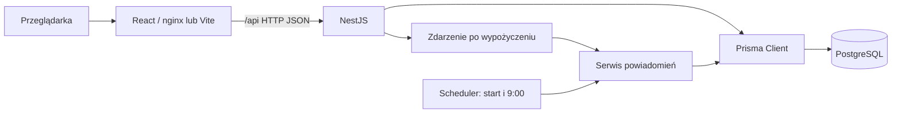
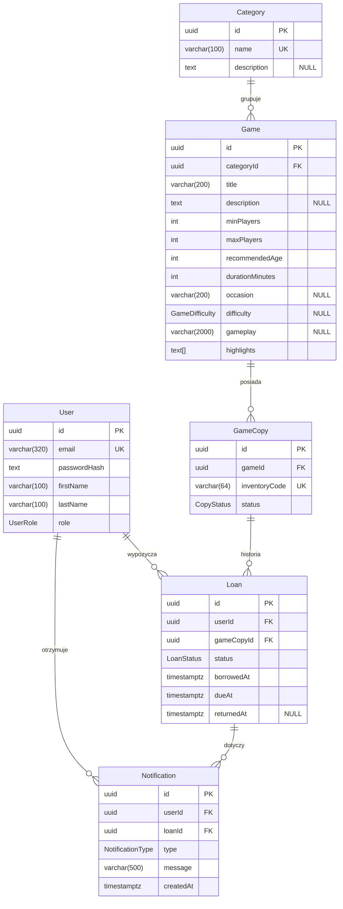

# BoardRent

Aplikacja wypożyczalni gier planszowych na ZTPAI: katalog, dostępność fizycznych egzemplarzy, potwierdzanie odbioru i zwrotu, historia i powiadomienia. Autor: Adrian Bober, 152685, adrian.bober@student.pk.edu.pl.

## Technologie i architektura

Frontend: React 19, TypeScript, Vite i CSS. Backend: NestJS 12, TypeScript, Prisma 6, PostgreSQL 17, JWT HS256, Argon2id, walidacja DTO i Swagger/OpenAPI. Testy: Vitest, Supertest i runner Node.js. Dokładne wersje określają pliki `package-lock.json`.



Kontrolery obsługują HTTP, DTO walidują dane, guards sprawdzają tożsamość i rolę, a serwisy realizują reguły i transakcje. Prisma zapewnia dostęp do bazy i migracje. Backend sam egzekwuje ograniczenia niezależnie od formularzy. nginx w Compose i Vite lokalnie przekazują `/api` do backendu; przy tym układzie nie trzeba konfigurować CORS.

## Model bazy danych — diagram ERD

Diagram odpowiada [schematowi Prisma](backend/prisma/schema.prisma) i [migracjom PostgreSQL](backend/prisma/migrations). Nazwy encji i atrybutów pochodzą z modeli Prisma; tabele w bazie to `users`, `categories`, `games`, `game_copies`, `loans` i `notifications`. PK oznacza klucz główny, FK klucz obcy, UK unikalność pojedynczego pola. `NULL` oznacza pole opcjonalne.



Każda relacja `||--o{` oznacza jednego wymaganego rodzica i zero lub wiele rekordów potomnych. Przykładowo egzemplarz należy do dokładnie jednej gry, ale gra może nie mieć jeszcze egzemplarzy. Jedna kopia może mieć wiele historycznych wypożyczeń. Powiadomienie wskazuje zarówno odbiorcę, jak i wypożyczenie. Wszystkie klucze obce mają `ON DELETE RESTRICT`.

Diagram pokazuje najważniejsze atrybuty. Wszystkie encje mają `createdAt`, a poza Notification również `updatedAt`; daty w PostgreSQL mają typ `timestamptz(3)`. Dodatkowe ograniczenie **UNIQUE (loanId, type)** w Notification dopuszcza tylko jedno powiadomienie danego typu dla danego wypożyczenia. Pola `loanId` i `type` nie są osobno unikalne.

| Typ wyliczeniowy | Wartości |
| --- | --- |
| UserRole | USER, ADMIN |
| GameDifficulty | EASY, MEDIUM, HARD |
| CopyStatus | AVAILABLE, MAINTENANCE, RETIRED |
| LoanStatus | ACTIVE, RETURNED |
| NotificationType | LOAN_BORROWED, LOAN_OVERDUE_REMINDER |

Migracje definiują również dwa **częściowe indeksy unikalne**, których warunku nie przedstawia standardowy Mermaid ERD:

- `loans_one_active_per_copy` — UNIQUE na `loans(game_copy_id)` wyłącznie dla `status = 'ACTIVE'`: jeden egzemplarz może mieć najwyżej jedno aktywne wypożyczenie.
- `loans_one_active_per_user` — UNIQUE na `loans(user_id)` wyłącznie dla `status = 'ACTIVE'`: użytkownik może mieć najwyżej jedno aktywne wypożyczenie.

Wpisy RETURNED nie podlegają tym dwóm ograniczeniom, więc historia może zawierać wiele wypożyczeń użytkownika lub egzemplarza. Indeksy są zapisane w migracjach SQL, poza deklaracjami unikalności schematu Prisma.

## Funkcje i role

Katalog ma kategorie, paginację dopasowaną do kolumn, wyszukiwarkę w nagłówku z podpowiedziami, okienko informacji i szczegóły gry. Pokazuje dostępne i wypożyczone kopie oraz planowane zwroty, bez danych wypożyczających. Kolor ilustracji jest wspólny dla kafelka, podpowiedzi i szczegółów.

| Rola | Dostęp |
| --- | --- |
| Gość | Katalog, szczegóły, zasady, rejestracja i logowanie. |
| USER | Wypożyczenie konkretnego egzemplarza, własny zwrot, historia, powiadomienia, pobranie potwierdzenia. |
| ADMIN | Powyższe oraz CRUD kategorii, gier i egzemplarzy, historia wszystkich wypożyczeń z filtrami. Zwrot nadal dotyczy tylko własnych wypożyczeń. |

Rejestracja tworzy USER; hasło 8–128 znaków. Administrator tworzony skryptem: 12–128 znaków. Hasła są haszowane Argon2id. Nowe JWT celowo nie mają `exp` (`expiresIn: null`), bez wylogowywania po czasie. Każde chronione żądanie sprawdza bieżące konto i rolę w bazie. Sesja jest w `sessionStorage` bieżącej karty. Wylogowanie usuwa ją i przeładowuje stronę; nie unieważnia skopiowanego tokenu na serwerze. Zmiana sekretu unieważnia wszystkie tokeny. Nie ma refresh tokenów ani endpointu logout.

## Reguły biznesowe

| Reguła | Egzekwowanie |
| --- | --- |
| Jedno ACTIVE na użytkownika | `LoansService`, transakcja Serializable i indeks częściowy `loans_one_active_per_user`; konflikt 409. |
| Tylko AVAILABLE bez aktywnego wypożyczenia | Kontrola serwisu, transakcja i indeks `loans_one_active_per_copy`; konflikt 409. |
| Jeden skuteczny zwrot | Kolejny zwrot daje 409, nie nadpisuje daty. Cudzy lub nieistniejący rekord daje 404. |
| Egzemplarz z historią pozostaje przy tej samej grze | `GameCopiesService.update` odrzuca zmianę `gameId` przez 409, również po zwrocie; inne edycje są dozwolone. |

Okres to **14 × 24 godziny** od daty serwera. Potwierdzenie odbioru tworzy ACTIVE, potwierdzenie oddania zapisuje RETURNED. Zwrot nie zmienia stanu technicznego MAINTENANCE/RETIRED. Aktywne wypożyczenie po terminie również zajmuje limit użytkownika. Termin nie gwarantuje faktycznego zwrotu. Brak rezerwacji, płatności i przedłużeń.

Konflikty serializacji ponawiają całą transakcję, maksymalnie trzy próby. Indeksy SQL chronią także przed równoczesnymi zapisami; stosuj migracje zamiast samego `prisma db push`.

## Docker Compose

Wymagania: Docker z Compose obsługującym `up --wait` (Windows: aktualny Docker Desktop, Linux containers), wolne porty 3000, 5173 i 5432. Polecenia wykonuj w PowerShell w katalogu głównym repozytorium. Dla developmentu, testów oraz skryptów danych potrzebny jest również Node.js 22.18+ lub 24 i npm; samo uruchomienie trzech kontenerów nie wymaga Node.js na hoście.

```powershell
if (!(Test-Path backend/.env)) { Copy-Item backend/.env.example backend/.env }
```

W nieśledzonym `backend/.env` ustaw własny losowy `AUTH_JWT_SECRET` o długości co najmniej 32 bajtów. Wygeneruj go menedżerem haseł albo, jeśli masz Node.js:

```powershell
node -e "console.log(require('node:crypto').randomBytes(48).toString('base64'))"
```

Nie dodawaj `.env`, haseł ani tokenów do Git. Dane PostgreSQL z `.env.example` są publiczną konfiguracją lokalną. Zmieniając `POSTGRES_USER`, `POSTGRES_PASSWORD`, `POSTGRES_DB` lub port, dostosuj `DATABASE_URL` dla skryptów na hoście. Compose buduje wewnętrzny URL do `db:5432`; użyj hasła bez znaków wymagających kodowania URL. Zmiana zmiennych PostgreSQL nie aktualizuje hasła w istniejącym wolumenie.

Opcjonalne `POSTGRES_PORT` i `FRONTEND_PORT` w `backend/.env` zmieniają porty hosta (domyślnie 5432 i 5173). Backend w Compose ma stały port hosta 3000. Lokalne `PORT` dotyczy uruchomienia NestJS poza Compose. Zmienne ustawione już w terminalu mogą nadpisywać wartości pliku `.env`.

```powershell
docker compose --env-file backend/.env up -d --build --wait
docker compose --env-file backend/.env ps
```

Compose czeka na bazę, stosuje istniejące migracje, uruchamia API i frontend. Pierwszy build wymaga internetu. Adresy:

- Aplikacja: http://localhost:5173
- API: http://localhost:3000/api
- Swagger: http://localhost:3000/api/docs (również przez frontend `/api/docs`)
- OpenAPI JSON: http://localhost:3000/api/docs-json

Nowa baza ma pusty katalog. Dane dodaj według następnej sekcji. Logi: `docker compose --env-file backend/.env logs --tail 100 backend frontend db`. Zatrzymanie: `docker compose --env-file backend/.env down`. Wolumen `boardrent-postgres-data` zachowuje dane w przestrzeni projektu Compose. Nie dodawaj `-v`, jeśli chcesz je zachować.

## Dane demonstracyjne i administrator

Skrypty zarządzające uruchamiaj lokalnie: wymagany Node.js **22.18+ lub 24**, npm oraz działająca, zmigrowana baza. Skrypty nie są automatycznie uruchamiane przez Compose ani dołączone do obrazu backendu. `DATABASE_URL` w `backend/.env` musi wskazywać bazę przez port hosta (domyślnie localhost:5432).

```powershell
Set-Location backend
npm.cmd ci
npm.cmd run db:generate
npm.cmd run db:seed-demo
```

Seed dodaje 14 fikcyjnych gier, kategorie i egzemplarze. Ponowne uruchomienie nie dubluje tych samych wpisów; uzupełnia brakujące pola poradnika istniejących gier demonstracyjnych. Nie usuwa historii.

Dla ADMIN dodaj lokalnie do `backend/.env`: `ADMIN_EMAIL`, `ADMIN_PASSWORD`, `ADMIN_FIRST_NAME`, `ADMIN_LAST_NAME`. Wybierz nieużywany e-mail, hasło 12–128 znaków i imię/nazwisko 1–100 znaków. Nadal w `backend`:

```powershell
npm.cmd run db:create-admin
Set-Location ..
```

Skrypt tworzy nowe konto z Argon2id. Istniejącego konta nie zmienia ani nie podnosi jego roli. Po utworzeniu usuń `ADMIN_PASSWORD` z `.env`; logowanie odbywa się zwykłym formularzem. USER zarejestruj przez stronę. Repozytorium nie udostępnia wspólnego hasła do konta.

## Development na Windows

Alternatywą dla pełnego Compose jest `dev.cmd` (Node/npm, Docker Desktop lub własny PostgreSQL). Nie uruchamiaj obu wariantów na tych samych portach. Przed przełączeniem: `docker compose --env-file backend/.env stop backend frontend`.

```powershell
$env:TZ = 'Europe/Warsaw'
.\dev.cmd
.\dev.cmd status
.\dev.cmd logs
```

Launcher przygotowuje brakującą konfigurację i sekret, zależności, Prisma Client i migracje, w razie potrzeby uruchamia bazę oraz restartuje własne serwery. Sprawdza API, bazę i katalog przez frontend; przy błędzie pokazuje etap i logi. Nie zamyka obcych procesów na portach. `dev.cmd restart` restartuje serwery, a `dev.cmd stop` zatrzymuje własne procesy bez usuwania bazy. Nie monitoruje usług po zakończeniu startu. Dla lokalnego schedulera ustaw `TZ=Europe/Warsaw` przed startem backendu.

Ręczny start API w `backend`: `npm.cmd ci`, `npm.cmd run db:generate`, `npm.cmd run db:deploy`, `npm.cmd run start:dev`. W drugim terminalu w `frontend`: `npm.cmd ci`, `npm.cmd run dev`. Konfiguracja: `DATABASE_URL`, `AUTH_JWT_SECRET`, opcjonalnie `PORT` (3000). Proxy Vite zakłada port 3000. Opcjonalny `VITE_API_BASE_URL` działa w czasie budowania frontendu; standardowo pozostaw `/api`.

## Powiadomienia i scheduler

Po zatwierdzeniu wypożyczenia zdarzenie w pamięci procesu uruchamia asynchroniczny zapis `LOAN_BORROWED`. Własne wpisy są pod `GET /api/notifications/me` i w interfejsie. Nagłe zatrzymanie między transakcją a obsługą zdarzenia może zgubić potwierdzenie; brak trwałej kolejki.

Scheduler działa na starcie i codziennie o **9:00 strefy procesu**, w Dockerze Europe/Warsaw. Tworzy `LOAN_OVERDUE_REMINDER` dla ACTIVE z `dueAt < teraz`. Unikalność `(loanId,type)` i `skipDuplicates` oznacza **jedno przypomnienie danego typu na wypożyczenie**, nie codzienne duplikaty. Lista jest odświeżana na żądanie; brak e-maili, WebSocketów i oznaczania jako przeczytane.

## Testy

Przed buildem backendu zatrzymaj jego lokalny watcher (`dev.cmd stop`), ponieważ oba używają katalogu `dist`. Po kontrolach przywróć development przez `dev.cmd`. Testy można też wykonywać obok pełnego Compose, którego pliki wynikowe są odizolowane w kontenerach.

Wymagane lokalne zależności obu pakietów (`npm.cmd ci` w każdym) i wygenerowany Prisma Client. Z katalogu głównego:

```powershell
Set-Location backend
npm.cmd run build
npm.cmd run lint
npm.cmd test
npm.cmd run test:e2e
Set-Location ../frontend
npm.cmd run build
npm.cmd run lint
npm.cmd test
Set-Location ..
```

`test:e2e` sprawdza HTTP, walidację i uprawnienia z atrapą Prisma. `test:db` wymaga **osobnej bazy testowej**, migracji i jawnego `TEST_DATABASE_URL`; [instrukcja](backend/README.md#testy-postgresql). Nigdy nie wskazuj bazy aplikacji. Zestaw obejmuje trwały zapis, wyścigi, indeksy i deduplikację powiadomień. Wyniki i liczbę zaliczonych testów wypisują uruchomione polecenia.

## Dokumentacja i kod źródłowy

- [Backend: endpointy API, model danych i testy PostgreSQL](backend/README.md)
- [Frontend: widoki i zachowanie interfejsu](frontend/README.md)
- [Schemat Prisma: sześć powiązanych encji](backend/prisma/schema.prisma)
- [Migracje PostgreSQL, w tym częściowe indeksy unikalne](backend/prisma/migrations)
- [Konfiguracja Docker Compose](compose.yaml)

Pełne schematy żądań, odpowiedzi i błędów są dostępne w Swaggerze uruchomionej aplikacji pod `/api/docs`.
